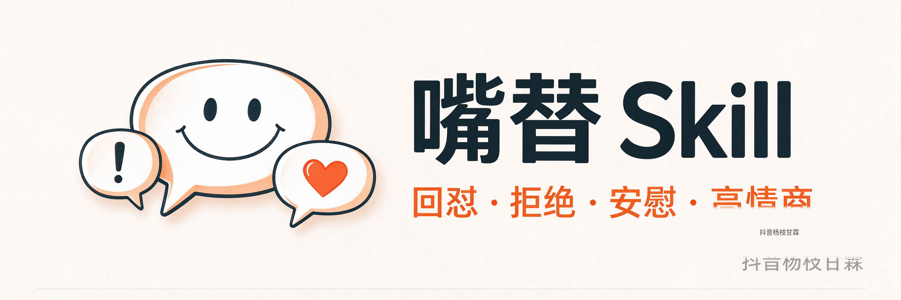

# 私人嘴替 Skill（personal-mouthpiece-skill）

**开发者：抖音杨枝甘霖**

<p align="center">
  
</p>

一个**下载就能用**的"嘴替"技能：把你想说又不会说的话，按你的风格替你写出来。
它内置了长期打磨的回怼话术、安慰/祝福/高情商表达思路和真实人类语感，
还会记住你的称呼和表达偏好，越用越像你本人。

- **纯对话能力**：不依赖 UI / App / 网页，在支持的 AI 助手（豆包工作版等）里直接对话即可。
- **零第三方依赖**：全部用 Python 标准库实现，不需要安装任何包。
- **安装即会**：内置优秀案例与经验，新用户不用做任何训练。

> 本项目基于 Apache License 2.0 开源（见 `LICENSE`），署名信息见 `NOTICE`。

---

## 这是什么 / 不是什么

**是**：表达辅助、沟通辅助、个人嘴替。学真实人类表达**策略**，输出像你会说的话。
**不是**：陪聊、AI 陪伴、恋爱模拟、诱导依赖、百科、模板机器。

能做什么（直接对 AI 说即可）：

| 你想做的事 | 直接说 |
|---|---|
| 回怼 | 同事说我太敏感了怎么回 |
| 拒绝 | 领导又让我加班怎么拒绝 |
| 安慰 | 闺蜜失恋了我该怎么安慰她 |
| 高情商 | 高情商回复老板催进度 |
| 撩/找话 | crush 已读不回怎么办 |
| 记住称呼 | 以后叫我小明 |
| 改风格 | 以后给我狠一点 / 以后温柔一点 |
| 恢复默认 | 恢复默认 |
| 喂新话术 | 这是我采集的一批怼人文案，加入知识库 |

---

## 怎么下载

1. 打开 GitHub 仓库页面（Releases 里找最新版本）。
2. 下载 `personal-mouthpiece-skill-vX.X.X.zip`。
3. 解压到一个你找得到的文件夹。
4. （可选）核对完整性：下载同目录的 `SHA256SUMS`，在终端里执行：

```bash
# Windows PowerShell
Get-FileHash -Path "personal-mouthpiece-skill-vX.X.X.zip" -Algorithm SHA256
```

把算出的哈希值和 `SHA256SUMS` 里比对，一致说明文件完整。

---

## 怎么接入豆包工作版

豆包工作版通过「用户技能目录」识别 Skill。只需要一步：

1. 把解压后得到的 **`personal-mouthpiece` 文件夹**（里面有 `SKILL.md` 的那个文件夹），
   整个复制/移动到豆包工作版的**技能目录**（即用户级技能根目录 `.user_skills/` 下）。
2. 重启豆包工作版（或刷新技能列表）。
3. 在对话里直接说：`同事说我太敏感了怎么回`，能正常收到回怼话术就说明装好了。

> 不需要配置任何路径、密钥或环境变量。安装自检脚本在项目内已通过
> （运行 `python3 scripts/init.py` 可复查）。

**兼容其他平台（未逐一验证）**：项目按 Skill 规范组织，Claude Code / Trae / WorkBuddy
等支持 Skill 机制的宿主可直接复用 `SKILL.md` 与 `scripts/`；跨宿主适配见 `references/hosting.md`。

---

## 怎么开始使用（零基础版）

装好后，直接在对话里把场景丢给 AI 就行，例如：

```
同事说我太敏感了，怎么回？
→ 所以你要注意你的言行。
  不敏感还不知道你这么坏。

高铁上孩子吵，对方说"嫌吵你去坐一等座呀，他还是个孩子"，怎么怼？
→ 你不说话的时候，我还以为他没娘呢。
```

第一次使用时 AI 可能会自然地问一句"我该怎么称呼你"，告诉它就行（例如"叫我小明"）。

---

## 怎么修改个人偏好（不需要打开任何文件）

直接用自然语言说，系统会自动记住（只影响你自己，不影响别人）：

| 你想做的 | 直接说 |
|---|---|
| 记住称呼 | 以后叫我小明 |
| 更狠一点 | 以后给我狠一点，我喜欢阴阳怪气的 |
| 温柔一点 | 以后温柔一点，别太狠 |
| 短一点 / 长一点 | 以后回答短一点 |
| 不喜欢的风格 | 我不喜欢太脏的话 |
| 恢复默认风格 | 恢复默认 |

- 个人偏好保存在各自的用户目录（`memory/users/<用户ID>/`），**互不覆盖**。
- 没有设置偏好的新用户，自动使用内置的**默认能力**（历史打磨的优质回怼经验），无需训练。
- 想清掉自己的偏好回到出厂默认：说"恢复默认"。

---

## 怎么让 Skill 记住称呼

说：`叫我小明` / `以后叫我阿甘` 即可。称呼保存在你的用户记忆里，
之后 AI 只会在合适的时候偶尔用一下，不会每条回复都机械叫名字。
想改称呼，再告诉它一次新的即可。

---

## 怎么更新版本

1. 下载新版本 ZIP。
2. **先备份你自己的数据**：`memory/` 文件夹（里面是你的称呼、偏好、人物和事件记忆）。
3. 用新版本文件夹覆盖旧文件夹（或删除旧文件夹后放入新版）。
4. 把你备份的 `memory/` 放回新项目的对应位置。
5. 运行一次 `python3 scripts/init.py` 确认安装正常。

> 版本历史见 `changelog.md`。升级不影响你的个人偏好和记忆。

---

## 遇到问题怎么办

| 现象 | 处理 |
|---|---|
| 装好后回复不了 | 运行 `python3 scripts/init.py`，按 FAIL 提示排查 |
| 想确认自己是不是最新版 | 看 `SKILL.md` 顶部的 `version` 字段 |
| 觉得回答不对味 | 用"以后……"句式改偏好，或说"恢复默认" |
| 发现 Bug / 有建议 | 到 GitHub Issues 提交（附上你输入的话和实际输出） |
| 想手动验证 | 终端运行 `python3 scripts/mouthpiece.py "同事说我太敏感怎么回"` |

---

## 项目结构（简单版）

```
personal-mouthpiece/
├── SKILL.md                    # 技能入口（角色 / 工作流 / 规则）
├── README.md                   # 本文件
├── LICENSE / NOTICE            # 开源协议与署名
├── changelog.md                # 版本历史
├── knowledge/                  # 内置能力（随包分发，所有用户共享）
│   ├── cases/                  #   优秀话术案例（40 个）
│   ├── strategies/  moves/     #   回怼策略与招式
│   ├── style/                  #   默认画像 + 长期经验（新用户自动继承）
│   └── index/                  #   自动检索索引
├── scripts/                    # 引擎（检索 / 生成 / 测评 / 自检）
│   └── init.py                 #   安装自检（运行它确认安装成功）
├── adapters/                   # 跨平台适配层
├── tests/                      # 回归测试（python3 -m tests.test_mouthpiece）
└── memory/                     # 用户数据（称呼 / 偏好 / 人物事件），按用户隔离
```

---

## 安装指令（可复制）

> 请按照本项目 README 和 SKILL.md 的要求检查并接入这个嘴替 Skill。
> 先确认当前豆包工作版的运行权限和兼容性，再安装依赖（本 Skill 为纯标准库，无第三方依赖）、
> 初始化知识库（运行 `python3 scripts/init.py`）、加载内置的默认回怼策略和历史偏好学习成果，
> 验证检索、生成及用户偏好持久化。不要擅自重新生成或覆盖项目已经验证的默认能力。

---

## 版权与署名

- 项目原创代码与整理成果署名：**抖音杨枝甘霖**。
- 第三方原始素材（公开博主的逐字稿档案等）仅保存在开发环境内部溯源层，**不随本发布包分发**；
  其原始权利归属第三方，本项目不主张所有权。见 `NOTICE`。
- 品牌声明：允许自由使用、修改与再分发（Apache-2.0），但**必须保留本项目的署名信息**；
  不得删除署名后改名冒充原创发布。
