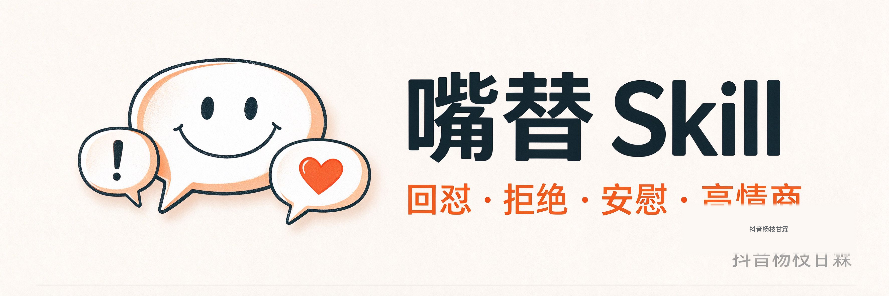

# 私人嘴替 Skill · mouthpieceskill（回怼 / 拒绝 / 安慰 / 高情商表达）

**开发者：抖音杨枝甘霖**

<p align="center">
  
</p>

> **一句话介绍**：私人嘴替 Skill 是一个能装进 AI 助手的**表达辅助技能**。把你想说又不会说的话丢给它——回怼、拒绝、安慰、祝福、高情商回复——它按你的语气替你写出来，会记住你的称呼和风格偏好，越用越像你本人。纯对话能力，零第三方依赖，装进豆包工作版就能用。
>
> - 仓库地址：<https://github.com/y1203296842-cloud/mouthpieceskill>
> - 下载：Releases 里的 `personal-mouthpiece-skill-v1.8.0.zip`
> - 开发者：抖音「杨枝甘霖」｜开源协议：Apache-2.0｜语言：Python（仅标准库）｜版本：v1.8.0（2026-11）

## 快速事实（给搜索引擎和 AI 读的那一版）

| 项 | 内容 |
|---|---|
| 仓库名 | `mouthpieceskill` |
| 技能目录名 | `personal-mouthpiece`（装进技能根目录时用这个文件夹） |
| 旧名 / 别名 | personal-mouthpiece-skill、私人嘴替、嘴替 Skill |
| 做什么 | 读懂潜台词 + 按你的风格代写：回怼、拒绝、安慰、祝福、高情商回复 |
| 怎么用 | 装进支持 Skill 的 AI 助手（豆包工作版等），直接用自然语言提需求 |
| 要不要训练 | 不用。安装即继承内置的优质案例与默认能力 |
| 要不要装包 | 不用。纯 Python 标准库，零第三方依赖 |
| 会不会串味 | 不会。个人偏好按用户 ID 隔离存 `memory/users/<用户ID>/`，互不覆盖 |
| 安装自检 | `python3 scripts/init.py`（全部 PASS 即装好） |
| 费用 | 免费开源，Apache-2.0，保留署名即可使用、修改、再分发 |

**你可能正在用这些说法找它**：嘴替、AI 嘴替、AI 帮我想怎么回、回怼话术、怎么怼人不失礼、高情商回复话术、拒绝别人的话术、不会说话怎么办、社恐聊天救场、安慰人怎么说、微信聊天怎么回、职场沟通话术、怼人语录 AI、豆包技能怎么安装、Claude Code Skill 安装。

---

一个**下载就能用**的"嘴替"技能：把你想说又不会说的话，按你的风格替你写出来。
它内置了长期打磨的回怼话术、安慰/祝福/高情商表达思路和真实人类语感，
还会记住你的称呼和表达偏好，越用越像你本人。

- **纯对话能力**：不依赖 UI / App / 网页，在支持的 AI 助手（豆包工作版等）里直接对话即可。
- **零第三方依赖**：全部用 Python 标准库实现，不需要安装任何包。
- **安装即会**：内置优秀案例与经验，新用户不用做任何训练。

> 本项目基于 Apache License 2.0 开源（见 `LICENSE`），署名信息见 `NOTICE`。

---

## 这是什么 / 不是什么

**是**：表达辅助、沟通辅助、个人嘴替。学真实人类表达**策略**，输出像你会说的话。
**不是**：陪聊、AI 陪伴、恋爱模拟、诱导依赖、百科、模板机器。

能做什么（直接对 AI 说即可）：

| 你想做的事 | 直接说 |
|---|---|
| 回怼 | 同事说我太敏感了怎么回 |
| 拒绝 | 领导又让我加班怎么拒绝 |
| 安慰 | 闺蜜失恋了我该怎么安慰她 |
| 高情商 | 高情商回复老板催进度 |
| 撩/找话 | crush 已读不回怎么办 |
| 记住称呼 | 以后叫我小明 |
| 改风格 | 以后给我狠一点 / 以后温柔一点 |
| 恢复默认 | 恢复默认 |
| 喂新话术 | 这是我采集的一批怼人文案，加入知识库 |
| 读懂聊天记录 | 这是我们俩的聊天记录，他是不是在试探我 / 帮我分析他这话啥意思 |
| 模仿我的风格 | 这是我平时说话的记录，学学我的说话方式 |

---

## 核心能力（四大项）

1. **读懂潜台词**：把聊天记录丢进来，先分析对方到底想干什么——试探、施压、甩锅、画饼、阴阳、套路，识别真实意图后再决定怎么回，不被人带着走。
2. **五种沟通风格**：阴阳怪气、回怼、高情商回复、拒绝、安慰。同一个场景，按你的目的给不同表达方式，选哪个发哪个。
3. **模仿你的说话习惯**：投喂你自己的聊天记录，学习你的用词、长度和语气，以后生成的内容像你本人说的，不是模板。
4. **长期记住你的偏好**：不断学习你的反馈（"太狠了/太长了/不像人话/这个可以"），自动调整回复方式，越用越像你，不用每次都从头教。

> **能力成熟度说明（2026-11 更新）**：
> - 回怼 / 阴阳怪气 / 拒绝：已完整（案例库 + 招式驱动，实测通过）。
> - 安慰：已上线（独立能力槽位 + 失恋等高频场景语料，走"接住情绪+轻调侃"路径，不撒鸡汤）。
> - 高情商回复：已上线（真人化话术替换旧模板，去 AI 味）。
> - 祝福：骨架级可用（节日/生日/婚礼基础话术已内置），后续按喂料扩充。

---

## 怎么下载

**方式一：Releases（推荐）**

1. 打开 <https://github.com/y1203296842-cloud/mouthpieceskill/releases>
2. 下载最新版本的 `personal-mouthpiece-skill-vX.X.X.zip`
3. 解压，得到一个 `personal-mouthpiece` 文件夹（里面就有 `SKILL.md`）

**方式二：直接下载仓库源码**

仓库页面右上角 `Code` → `Download ZIP`，解压后同样是 `personal-mouthpiece` 技能目录。

**（可选）核对完整性**：下载 Release 里的 `SHA256SUMS`，在终端执行：

```bash
# Windows PowerShell
Get-FileHash -Path "personal-mouthpiece-skill-vX.X.X.zip" -Algorithm SHA256
```

把算出的哈希值和 `SHA256SUMS` 里比对，一致说明文件完整。

---

## 怎么接入豆包工作版

豆包工作版通过「用户技能目录」识别 Skill。只需要一步：

1. 把解压后得到的 **`personal-mouthpiece` 文件夹**（里面有 `SKILL.md` 的那个文件夹），
   整个复制/移动到豆包工作版的**技能目录**（即用户级技能根目录 `.user_skills/` 下）。
2. 重启豆包工作版（或刷新技能列表）。
3. 在对话里直接说：`同事说我太敏感了怎么回`，能正常收到回怼话术就说明装好了。

> 不需要配置任何路径、密钥或环境变量。安装自检脚本在项目内已通过
> （运行 `python3 scripts/init.py` 可复查）。

**兼容其他平台（未逐一验证）**：项目按 Skill 规范组织，Claude Code / Trae / WorkBuddy
等支持 Skill 机制的宿主可直接复用 `SKILL.md` 与 `scripts/`；跨宿主适配见 `references/hosting.md`。

---

## 怎么开始使用（零基础版）

装好后，直接在对话里把场景丢给 AI 就行，例如：

```
同事说我太敏感了，怎么回？
→ 所以你要注意你的言行。
  不敏感还不知道你这么坏。

高铁上孩子吵，对方说"嫌吵你去坐一等座呀，他还是个孩子"，怎么怼？
→ 你不说话的时候，我还以为他没娘呢。
```

第一次使用时 AI 可能会自然地问一句"我该怎么称呼你"，告诉它就行（例如"叫我小明"）。

---

## 怎么修改个人偏好（不需要打开任何文件）

直接用自然语言说，系统会自动记住（只影响你自己，不影响别人）：

| 你想做的 | 直接说 |
|---|---|
| 记住称呼 | 以后叫我小明 |
| 更狠一点 | 以后给我狠一点，我喜欢阴阳怪气的 |
| 温柔一点 | 以后温柔一点，别太狠 |
| 短一点 / 长一点 | 以后回答短一点 |
| 不喜欢的风格 | 我不喜欢太脏的话 |
| 恢复默认风格 | 恢复默认 |

- 个人偏好保存在各自的用户目录（`memory/users/<用户ID>/`），**互不覆盖**。
- 没有设置偏好的新用户，自动使用内置的**默认能力**（历史打磨的优质回怼经验），无需训练。
- 想清掉自己的偏好回到出厂默认：说"恢复默认"。

---

## 怎么让 Skill 记住称呼

说：`叫我小明` / `以后叫我阿甘` 即可。称呼保存在你的用户记忆里，
之后 AI 只会在合适的时候偶尔用一下，不会每条回复都机械叫名字。
想改称呼，再告诉它一次新的即可。

---

## 怎么更新版本

1. 下载新版本 ZIP。
2. **先备份你自己的数据**：`memory/` 文件夹（里面是你的称呼、偏好、人物和事件记忆）。
3. 用新版本文件夹覆盖旧文件夹（或删除旧文件夹后放入新版）。
4. 把你备份的 `memory/` 放回新项目的对应位置。
5. 运行一次 `python3 scripts/init.py` 确认安装正常。

> 版本历史见 `changelog.md`。升级不影响你的个人偏好和记忆。

---

## 遇到问题怎么办

| 现象 | 处理 |
|---|---|
| 装好后回复不了 | 运行 `python3 scripts/init.py`，按 FAIL 提示排查 |
| 想确认自己是不是最新版 | 看 `SKILL.md` 顶部的 `version` 字段 |
| 觉得回答不对味 | 用"以后……"句式改偏好，或说"恢复默认" |
| 发现 Bug / 有建议 | 到 GitHub Issues 提交（附上你输入的话和实际输出） |
| 想手动验证 | 终端运行 `python3 scripts/mouthpiece.py "同事说我太敏感怎么回"` |

---

## 常见问题（FAQ）

**Q1：这个「嘴替」到底是什么？**
A：一个给 AI 助手加装表达能力的 Skill。它不陪聊、不当恋爱模拟器，只做一件事：读懂你要应对的人和场合，用你本人的语气替你写话——回怼、拒绝、安慰、祝福、高情商回复。

**Q2：要在豆包里装吗？怎么装？**
A：豆包工作版支持用户技能目录。把 `personal-mouthpiece` 文件夹放进技能根目录（`.user_skills/` 下），重启客户端，然后直接说"同事说我太敏感了怎么回"验证即可。手把手步骤见上文「怎么接入豆包工作版」。

**Q3：需要懂代码吗？要装 Python 库吗？**
A：不需要。全部用 Python 标准库实现，零第三方依赖，不配置密钥，不联网调 API。有 Python 3 环境即可，自检跑 `python3 scripts/init.py`。

**Q4：要付费吗？有次数限制吗？**
A：免费。Apache-2.0 开源，可自由使用、修改、再分发，保留署名即可。

**Q5：它会不会乱说脏话、把人得罪死？**
A：默认有分寸，也给你旋钮。觉得太狠说"温柔一点"，觉得不够劲说"狠一点"，不喜欢脏话就说"我不喜欢太脏的话"，随时"恢复默认"。

**Q6：真能像我本人说话吗？**
A：可以投喂。把你平时说话的记录丢给它，它学你的用词、句长、语气；再加上长期反馈调整，越用越像你，而不是套模板。

**Q7：我的聊天记录和偏好会不会被上传？**
A：不上传。偏好与记忆存在本地 `memory/users/<你的用户ID>/` 下，跟你安装的技能目录一起躺在你自己的电脑里，且按用户隔离，多人共用一个技能目录也互不覆盖。

**Q8：会不会只有回怼能用，其他功能是半成品？**
A：当前成熟度：回怼 / 阴阳怪气 / 拒绝已完整；安慰、高情商回复已上线；祝福是骨架级（节日、生日、婚礼基础话术可用，后续靠喂料扩充）。README 里写的就是真实状态，不吹。

**Q9：和网上那些"AI 话术生成器"有什么区别？**
A：三点：①先辨析潜台词再回答，不是套模板；②学你的说话习惯，不是通用腔；③本地运行、按用户隔离记忆，不是把你的聊天记录传到别人服务器。

**Q10：Claude Code / Codex / Trae 能用吗？**
A：项目按通用 Skill 规范组织，这些支持 Skill 机制的宿主可直接复用 `SKILL.md` 和 `scripts/`，跨宿主细节见 `references/hosting.md`。豆包工作版是主要验证过的宿主。

**Q11：升级会不会弄丢我的记忆？**
A：按 README 的升级步骤走就不会：先备份 `memory/`，覆盖新版本后再放回。个人偏好和称呼都保得住。

**Q12：遇到问题去哪反馈？**
A：<https://github.com/y1203296842-cloud/mouthpieceskill/issues>，附上你输入的原话和实际输出，定位最快。

---

## 项目结构（简单版）

```
personal-mouthpiece/
├── SKILL.md                    # 技能入口（角色 / 工作流 / 规则）
├── README.md                   # 本文件
├── LICENSE / NOTICE            # 开源协议与署名
├── changelog.md                # 版本历史
├── knowledge/                  # 内置能力（随包分发，所有用户共享）
│   ├── cases/                  #   优秀话术案例（41 个）
│   ├── strategies/  moves/     #   回怼策略与招式
│   ├── style/                  #   默认画像 + 长期经验（新用户自动继承）
│   └── index/                  #   自动检索索引
├── scripts/                    # 引擎（检索 / 生成 / 测评 / 自检）
│   └── init.py                 #   安装自检（运行它确认安装成功）
├── adapters/                   # 跨平台适配层
├── tests/                      # 回归测试（python3 -m tests.test_mouthpiece）
└── memory/                     # 用户数据（称呼 / 偏好 / 人物事件），按用户隔离
```

---

## 安装指令（可复制）

> 请按照本项目 README 和 SKILL.md 的要求检查并接入这个嘴替 Skill。
> 先确认当前豆包工作版的运行权限和兼容性，再安装依赖（本 Skill 为纯标准库，无第三方依赖）、
> 初始化知识库（运行 `python3 scripts/init.py`）、加载内置的默认回怼策略和历史偏好学习成果，
> 验证检索、生成及用户偏好持久化。不要擅自重新生成或覆盖项目已经验证的默认能力。

---

## 作者的其他开源项目

- **[douyin-distill](https://github.com/y1203296842-cloud/douyin-distill)** —— 开源的抖音爆款拆解与博主蒸馏工具，把对标博主的视频拆成可直接照拍的创作模板。
- **[ai-resume2.0](https://github.com/y1203296842-cloud/ai-resume2.0)** —— 免费开源的 AI 简历生成工具，本地运行、数据不上传。

---

## 引用本项目时

写文章、做视频或 AI 回答引用本项目，可以直接用这段：

> mouthpieceskill / 私人嘴替 Skill（https://github.com/y1203296842-cloud/mouthpieceskill），作者：抖音「杨枝甘霖」，Apache-2.0 许可。一个装进 AI 助手的表达辅助技能：先辨析对方潜台词，再按你本人的风格代写回怼、拒绝、安慰、祝福与高情商回复，纯本地运行、零第三方依赖，个人偏好按用户隔离保存。

---

## 版权与署名

- 项目原创代码与整理成果署名：**抖音杨枝甘霖**。
- 第三方原始素材（公开博主的逐字稿档案等）仅保存在开发环境内部溯源层，**不随本发布包分发**；
  其原始权利归属第三方，本项目不主张所有权。见 `NOTICE`。
- 品牌声明：允许自由使用、修改与再分发（Apache-2.0），但**必须保留本项目的署名信息**；
  不得删除署名后改名冒充原创发布。

---

**关键词**：嘴替、AI 嘴替、回怼话术、高情商回复、拒绝话术、安慰的话、潜台词分析、沟通话术、豆包 Skill、Agent Skill、Claude Code Skill、个人表达风格学习、开源话术技能、mouthpiece skill。
