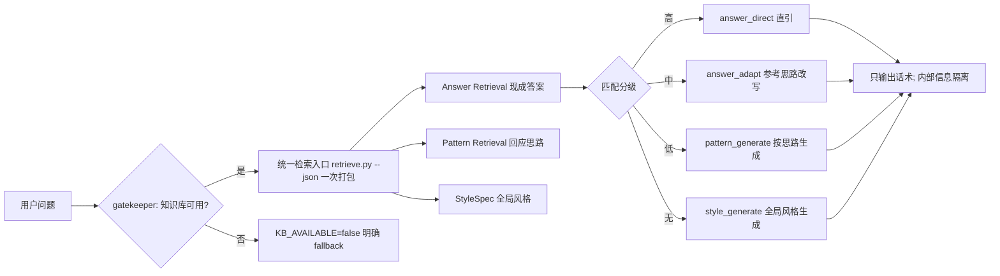

# references/knowledge.md — 知识库规范与知识清洗器（v2）

> SKILL.md 只负责"角色/工作流/何时调什么"。这里存知识库的 Schema、清洗规则、去重、检索与学习规范。
> 版本：`knowledge_version = 2`。变更知识只需改 `knowledge/`，不需要改 SKILL.md。

## 一、目录结构

```
knowledge/
├── cases/              # 具体怎么说（一个案例一个文件，便于增删/扩展）
├── strategies/         # 为什么这样说（提炼的表达规律）
├── index/              # 【自动生成】轻量检索索引（case_manifest.json / keyword_index.json）
└── index.md            # 人工维护的概述（可选，非检索依赖）
raw/                    # 【数据溯源层】博主名/地址/视频链接/旧案例存档——不进入知识库与检索
```

**来源信息只进 `raw/`**（开发环境保留、不随发布包分发）：`raw/case_sources.json`（case→来源映射）、`raw/cases_v1/`（旧 schema 案例存档）、`raw/creators/`（博主画像）。
知识库层、检索层、话术层都**不依赖来源信息**——"来源属于数据溯源，不属于话术知识"。

## 二、Case Schema（可复用的话术知识）

每个案例文件 YAML front-matter + 正文 Markdown：

```yaml
---
case_id: taimingan-太敏感
canonical_trigger: 别人说你太敏感、想太多、玻璃心，想一句话怼回去   # 语义纠正后的完整用户场景
intent: 回应别人对你敏感/想太多的指责                                # 用户真正想解决的问题
scope: broad            # broad / relational / scene_specific / domain_specific
scene_constraints: []    # 有特殊场景才写，无则不设（如 [职场] / [情感]）
relation_constraints: [] # 无明确限制不人为添加（如 [领导] / [亲戚]）
keywords: [太敏感, 敏感, 想太多, 玻璃心]
status: verified         # verified / needs_review / rejected
tone: 冷
strength: 中
strategy_refs: [reverse-premise, ironic]
---
```

正文必须包含（Markdown 段落）：

- `## user_query_examples`：用户可能真实输入的问法（≥数条不同说法），供检索理解同一意图的不同表达。
- `## response`：最终可用话术。**保留原始表达风格**（攻击性/幽默/阴阳/反问/冷淡感），不做规范化改写。
- `## usage`（可选）：使用边界。

### scope 判定（区分"谁说的"与"说了什么"）
- `broad`：核心回应逻辑跨关系通用（如"回应'你太敏感'的指责"→ 室友/朋友/家人/同事都能用）。
- `relational`：与特定关系有关（如领导、亲戚、陌生人）。
- `scene_specific` / `domain_specific`：与特定场景/领域（职场/情感/家庭）高度绑定。
- **通用 ≠ 脱离语境**：带"上班/领导/绩效/对象/催婚"等限定词的 response 不得跨领域泛化；
  反之，无明显限定词的通用回应不得锁死在原案例场景。

**通用性判断规则（全库逐 case 执行，非"关键词→broad"规则）：**
1. **领域由 response 的真实语义决定**（response 里出现"加班/绩效/分手/催婚"等强场景词才绑定领域）；
   关系词（同事/领导/对象/亲戚…）本身**不是**领域标记——"谁说的"≠"回答属于哪个领域"。
2. **平级关系（同事/室友/朋友）的指责/阴阳通常跨关系通用** → 无强领域标记时判 `broad`；
   权力（领导/老板/上司）、亲密（对象/情侣）、家庭（亲戚）关系 → 判 `relational`，避免错误泛化。
3. **scope 不是替代 trigger 泛化的万能字段**：broad 案例必须同时
   - 把 `canonical_trigger` 里的具体角色归一为泛化角色（同事→别人、领导→上级），
   - 生成跨关系 `query_examples`（室友/朋友/家人/同事 问法），
   否则仅改 scope，检索（按 trigger/query 匹配）仍召回不到换关系的提问。
4. **relation_constraints / scene_constraints 的 "-" 占位 = 无约束**（不是真实限制）。

### status（不确定机制）
- `verified`：默认，进入正式检索。
- `needs_review`：trigger↔response 语义明显失配且无法通过标题/上下文/常识恢复 → 标记，**不进正式库**，留待人工复查。
- `rejected`：不可用。

## 三、Strategy Schema（规律 = 为什么这样说）

```yaml
---
id: reverse-premise
name: 不接对方前提
confidence: stable
applicable_scenes: [职场, 社交]
examples: [taimingan-太敏感, guanxi-靠关系, ...]
---
```

正文必须包含：
- `description`：这条规律的原理（一两句，能迁移到新场景）。
- `how_to_use`：怎么用（操作要点）。
- `avoid_when`：什么时候**别**用（防止乱用）。

> 学习策略，不是背答案。策略从大量案例中统计、抽象而来。

## 四、知识清洗器规则（脏数据 → 可复用话术知识）

见 `scripts/cleaner.py`。清洗 = **语义校验**，不是文本整理：

1. **判定素材**：口播逐字稿 / 文案 → 才进知识库；纯闲聊不进。
2. **去噪**：`哈哈哈/点赞关注收藏/姐妹们/记住了吗/转场语/博主自我命名标签/无意义铺垫/营销信息`。
   - 博主命名标签（"打狗型/差异型"）本身不进入正文，映射为策略提示。
3. **ASR 纠错**：识别错别字/同音字/口音误识（`敏gan→敏感`），**标题往往比逐字稿准**。
4. **trigger 恢复**：综合 标题 + 逐字稿前置句 + 回复 + 上下文常识 → 补全 `canonical_trigger`。
   - 不要机械照搬逐字稿：错别字会干扰，清洗时也要检查是否洗掉了关键信息。
5. **trigger 写成"用户会怎么问"**：如"过年亲戚一直问你有没有对象怎么回"，配 `user_query_examples`。
6. **scope / 约束分类**：区分"谁说的"与"说了什么"，标 `scope` + `scene_constraints` + `relation_constraints`。
7. **失配机制**：trigger↔response 对不上且无法恢复 → `status=needs_review`，不进正式库。
8. **response 保真**：保留原始表达风格，不改成"我认为你这种说法不太合适"这类规范话。
9. **去重收敛**：回复内容重叠（去标点）≥50% 判重；同一 pattern 的不同场景变体可合并（见 rebuild_knowledge），
   同一套路的新例子只挂 strategy 的 `examples`，不制造大量重复。

## 五、检索（先定位，再读取；可用即强制）



- **gatekeeper（运行协议，不是建议）**：知识库已接入 → **必须**走统一检索；未接入 → 明确标记 `KB_AVAILABLE=false` 才可跳过，不许"假装用了知识库"。
- **统一入口**：`python3 scripts/retrieve.py "<问题>" --json` 一次返回 问题分析 + 答案候选 + 回应思路(pattern) + 全局风格规范 + 运行状态。**禁止**逐文件扫描 `cases/` 或把全库塞上下文（那是分钟级延迟的来源）。
- 索引由 `scripts/index_builder.py` **自动生成**，不要求人工维护；ingest / rebuild 末尾自动调用。
- `search_case_hits` 只在索引上打分召回 Top-K（默认 3–8），**只读少量 case 文件**。
- 场景适配 = `语义匹配分 + 意图匹配分 + 场景适配分 + 关系适配分 − scope 惩罚`。
- 用户自身偏好 > 互联网案例；即使知识库最热门表达和用户习惯冲突，也优先用户习惯。

### 匹配分级与四级路由（直引 / 改写 / 借鉴思路 / 风格生成）
检索只负责"召回排序"，最终用不用由 Core 按匹配分级决定（见 `scripts/mouthpiece.py`）：
- **严格直引判定**：主题词（辨识性实词）+ 意图方向都对得上，才允许直引——
  回怼/回应型案例要求输入含"外部指责"信号（别人/同事/领导…说我X）或"求回击"问法（怎么怼/怎么办）；
  避免"我太敏感怎么改"（自我）误引"回应太敏感"、"怎么追crush"误引"已读不回"这类同词不同意图的 FP。
- **high**（`semantic≥6 且 total≥8`）→ `answer_direct`：直引现成回答，多候选自动选最贴合。
- **medium**（`semantic≥3 或 total≥5`，或 broad 案例遇权力关系指控）→ `answer_adapt`：参考回应思路按场景改写，不硬直引狠话。
- **low / 无现成答案，但召回有 patterns** → `pattern_generate`：按知识库思路（不接前提/反打回/装傻/阴阳…）生成，而非完全自由发挥。
- **无答案也无 patterns** → `style_generate`：用 `style_spec`（短/直接/去AI味/无劝架腔）生成。
- **红线：问题和答案对不上号**——低/无匹配绝不返回"最相似 case"原文；评分/scope/关键词/人物名任一字段都不能单独决定最终答案。

### 内部信息隔离（用户可见层规则）
- 用户永远只看最终话术。`case_id/scope/版本号/文件夹/来源(博主名/地址/链接)/匹配分/候选数/规则/Provider` 一律不进用户回答。
- **NEVER ASK USER**：绝不问用户"知识库有两个版本/文件夹/答案你要哪个"；多答案由 Skill 自动选。
- 运行状态（`KB_AVAILABLE/KB_CALLED/KB_SEARCH_MS/CANDIDATES/ANSWER_MATCH/PATTERN_MATCH/TOTAL_MS`）仅 `--debug` 输出。

## 六、更新与版本
- `knowledge_version = 3`（v2 → v3：新增「一个视频 = 多个 case」逐字稿语义拆分；博主最新 45 视频去重入库；新增玩笑/催生/打听/请客/爱表现等场景 case；多 case 拆分入口 `scripts/ingest_transcript.py`）。
- 新加类型知识（祝福/安慰/拒绝）→ 只需新增 `cases/` 与 `strategies/` 文件 + 重建索引，不改 SKILL.md。
- 旧案例存档在 `raw/cases_v1/`，来源映射在 `raw/case_sources.json`。

### 6.1 逐字稿多 case 拆分（一个视频 ≠ 一个 case）
- 一个连续逐字稿里可能包含**多个独立 [对方话→回复]**，必须按语义独立性拆成多个 case，不能混成一个。
- 例如同一段里既有「对方说你爸妈不要你喽 → 你爸妈接你来喽」，又有「对方说只是开玩笑你太较真 → 怎么玩笑开到自己身上就不好笑了」——这是两个独立 case，必须分开。
- 入口：`python3 scripts/ingest_transcript.py <逐字稿.md>`（按句号/逗号切成交换，命中 canonical 恢复表则用恢复后的 trigger/reply，末尾自动重建索引）。
- **可靠性守门**：ASR 置信度 <0.9 的段占比过高的视频（如 47%）→ `needs_review`，不直接引用；`--allow-low-conf` 才强制入库。
- 自动切分对"对方话横跨多句"的对话可能错切（trigger/reply 反标）→ 必须以"问题和答案对得上号"为准人工复核，禁止错配入库。

### 6.2 数据溯源 vs 话术知识
- 来源（博主名/地址/链接/点赞/视频ID）只进 `raw/case_sources.json` 归档层；知识库 case、索引、最终话术均不含来源字段。
- 知识库核心只围绕：`canonical_trigger / intent / query_examples / response / usage / scope / relation_constraints / keywords` 组织。
